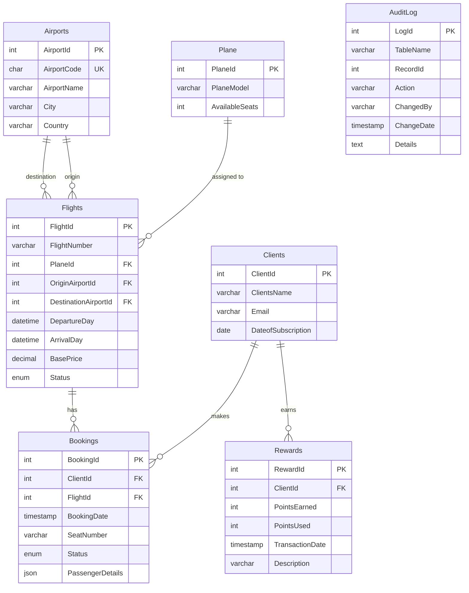

# Flight Service Database ER Diagram

## Entity-Relationship Diagram

## Database Schema Description

### Entities and Their Attributes

#### Clients
- **ClientId**: Primary key, integer, auto-increment
- **ClientsName**: Client's full name (VARCHAR)
- **Email**: Client's email address (VARCHAR)
- **DateofSubscription**: Date when the client registered (DATE)

#### Airports
- **AirportId**: Primary key, integer, auto-increment
- **AirportCode**: Unique 3-letter IATA airport code (CHAR)
- **AirportName**: Airport's full name (VARCHAR)
- **City**: City where the airport is located (VARCHAR)
- **Country**: Country where the airport is located (VARCHAR)

#### Plane
- **PlaneId**: Primary key, integer, auto-increment
- **PlaneModel**: Model of the aircraft (VARCHAR)
- **AvailableSeats**: Total number of seats available (INT)

#### Flights
- **FlightId**: Primary key, integer, auto-increment
- **FlightNumber**: Flight identifier code (VARCHAR)
- **PlaneId**: Foreign key to Plane (INT)
- **OriginAirportId**: Foreign key to Airports (origin) (INT)
- **DestinationAirportId**: Foreign key to Airports (destination) (INT)
- **DepartureDay**: Date and time of departure (DATETIME)
- **ArrivalDay**: Date and time of arrival (DATETIME)
- **BasePrice**: Base ticket price (DECIMAL)
- **Status**: Flight status (ENUM: "Scheduled", "Delayed", "Cancelled")

#### Bookings
- **BookingId**: Primary key, integer, auto-increment
- **ClientId**: Foreign key to Clients (INT)
- **FlightId**: Foreign key to Flights (INT)
- **BookingDate**: Date and time when booking was made (TIMESTAMP)
- **SeatNumber**: Selected seat number (VARCHAR)
- **Status**: Booking status (ENUM: "Confirmed", "Cancelled")
- **PassengerDetails**: JSON data containing passenger details

#### Rewards
- **RewardId**: Primary key, integer, auto-increment
- **ClientId**: Foreign key to Clients (INT)
- **PointsEarned**: Number of points earned (INT)
- **PointsUsed**: Number of points redeemed (INT)
- **TransactionDate**: Date and time of the transaction (TIMESTAMP)
- **Description**: Description of the transaction (VARCHAR)

#### AuditLog
- **LogId**: Primary key, integer, auto-increment
- **TableName**: Name of the table being audited (VARCHAR)
- **RecordId**: ID of the record being audited (INT)
- **Action**: Type of action (INSERT, UPDATE, DELETE) (VARCHAR)
- **ChangedBy**: User who made the change (VARCHAR)
- **ChangeDate**: Date and time of the change (TIMESTAMP)
- **Details**: Details of the change (TEXT)

### Relationships

1. **Clients to Bookings**: One-to-many (one client can have multiple bookings)
2. **Clients to Rewards**: One-to-many (one client can have multiple reward transactions)
3. **Flights to Bookings**: One-to-many (one flight can have multiple bookings)
4. **Plane to Flights**: One-to-many (one plane can be used for multiple flights)
5. **Airports to Flights (origin)**: One-to-many (one airport can be the origin for multiple flights)
6. **Airports to Flights (destination)**: One-to-many (one airport can be the destination for multiple flights)

### Constraints

1. **Unique Constraints**:
   - AirportCode in Airports table
   - (FlightId, SeatNumber) combination for Confirmed bookings

2. **Check Constraints**:
   - ArrivalDay must be after DepartureDay (in Flights)
   - Email must contain '@' and a domain (in Clients)
   - SeatNumber must follow pattern of 1-2 digits followed by a letter A-F (in Bookings)
   - PointsEarned and PointsUsed must be non-negative (in Rewards)

### Views

1. **ClientRewardPoints**: Calculates total points earned, used, and available for each client
2. **FlightAvailability**: Shows real-time seat availability for each flight

### Normalization

The database schema is in Third Normal Form (3NF):
- All attributes in each table are atomic (1NF)
- All non-key attributes are fully functionally dependent on the primary key (2NF)
- All non-key attributes are non-transitively dependent on the primary key (3NF) 