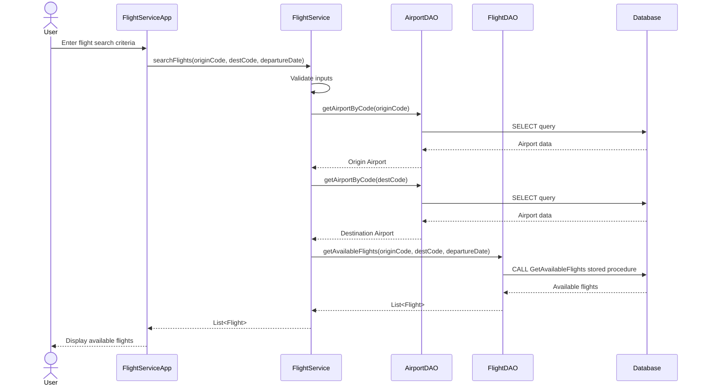
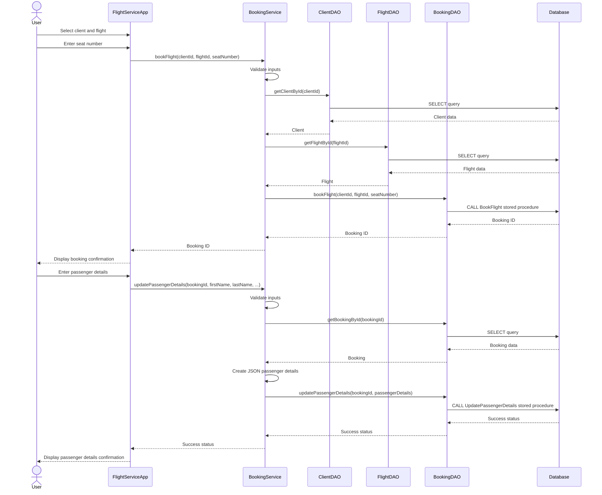
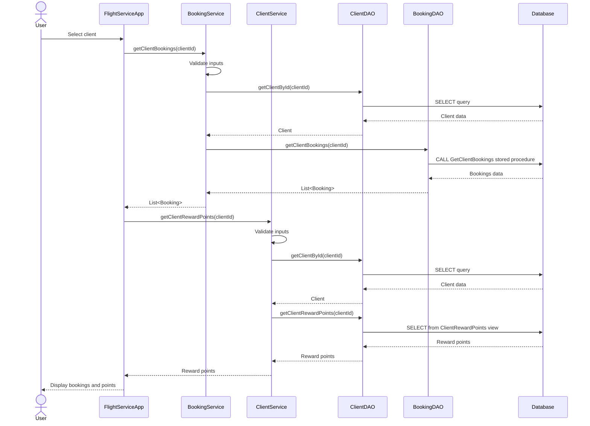
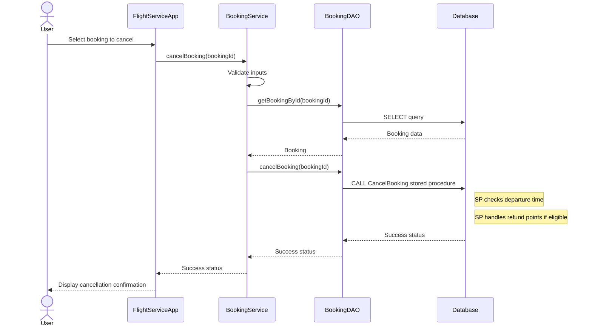
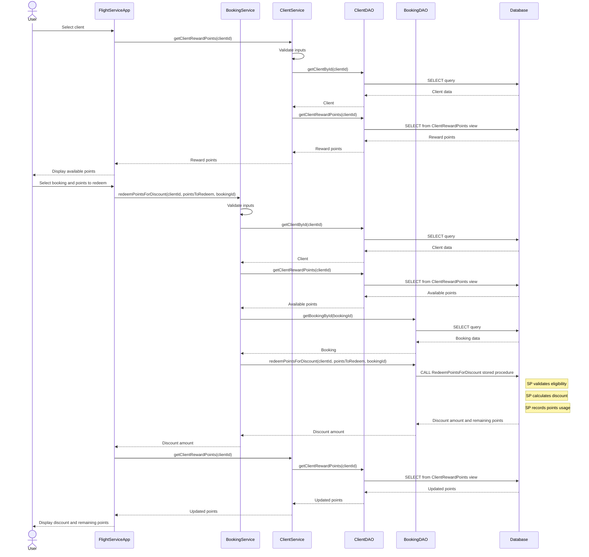
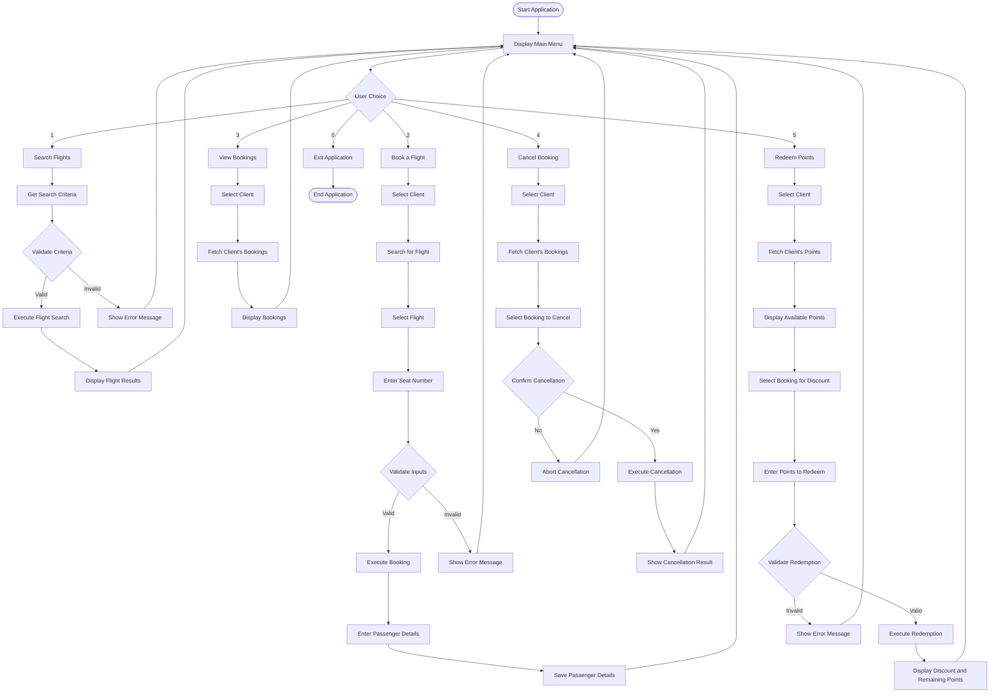

# Flight Service Sequence Diagrams

This document contains sequence diagrams for the five main workflows in the Flight Service application.

## Workflow 1: Search Flights

## Workflow 2: Book Flight

## Workflow 3: View Bookings

## Workflow 4: Cancel Booking

## Workflow 5: Redeem Points for Discount

## Activity Diagram: Overall System Flow

