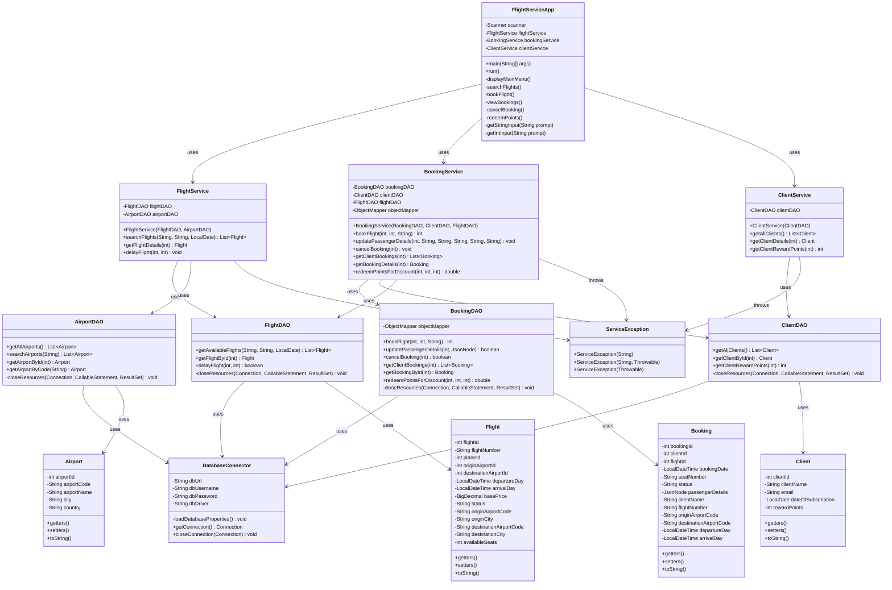

# Flight Service Java Application UML Diagram

## Class Diagram

## Application Architecture

The Flight Service Java application follows a layered architecture with clear separation of concerns:

### 1. Presentation Layer
- **FlightServiceApp**: Console-based user interface that handles user input and display of results.
- Responsibilities:
  - Providing a menu-based interface for users
  - Collecting input parameters for operations
  - Displaying results in a user-friendly format
  - Basic input validation

### 2. Business Logic Layer
- **FlightService**: Contains business logic related to flights and airports.
- **BookingService**: Contains business logic related to bookings and passenger details.
- **ClientService**: Contains business logic related to clients and reward points.
- **ServiceException**: Custom exception for business logic errors.
- Responsibilities:
  - Input validation
  - Enforcing business rules
  - Coordinating transactions across multiple DAOs
  - Transforming data between presentation and data access layers

### 3. Data Access Layer (DAL)
- **DatabaseConnector**: Handles database connection management.
- **AirportDAO**: Data access for Airport entity.
- **FlightDAO**: Data access for Flight entity.
- **BookingDAO**: Data access for Booking entity.
- **ClientDAO**: Data access for Client entity.
- Responsibilities:
  - Executing SQL queries and stored procedures
  - Converting resultsets to model objects
  - Managing database resources
  - Handling low-level database exceptions

### 4. Model Layer
- **Airport**: Represents airport data.
- **Flight**: Represents flight data.
- **Booking**: Represents booking data.
- **Client**: Represents client data.
- Responsibilities:
  - Storing data
  - Providing getters and setters
  - Basic data validation

## Design Patterns Used

1. **Data Access Object (DAO) Pattern**: Separates database access logic from business logic.
2. **Dependency Injection**: Services are injected with their dependencies via constructors.
3. **Exception Handling Pattern**: Custom exceptions for business logic errors.
4. **Model-View-Controller (MVC)**: Though adapted for a console application, the design follows MVC principles.

## Flow of Control

1. User interacts with the presentation layer (FlightServiceApp)
2. The presentation layer calls appropriate methods in the business logic layer
3. The business logic layer validates input and applies business rules
4. The business logic layer calls appropriate methods in the data access layer
5. The data access layer interacts with the database via stored procedures
6. Results flow back through the layers to be presented to the user 